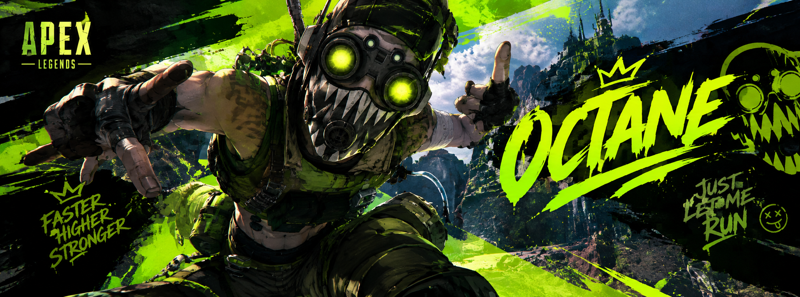

<!-- ================= OCTANE BANNER ================= -->

  

  <a href="https://fearlesswoofless-spec.github.io/Ulang-Portfolio/">
    🌐 Visit My Portfolio Website
  </a>
  |
  <a href="https://github.com/fearlesswoofless-spec">
    GitHub
  </a>

---

## 👋 About Me

Good morning, goodnight! I'm **Jan Kyle Ulang**, a fourth-year **BS Computer Engineering student at ICCT Cainta Colleges**.

I'm interested in **Databases, Networking, and Artificial Intelligence**. I have experience using Firebase and Supabase for database management, Java for application development, and Python for simple coding projects.

I also have experience using AutoCAD to create basic floor plans for our school projects.

I'm continuously learning and improving my skills through school projects, hands-on practice, and exploring new technologies.

---

## 💻 Skills

  
  
  
  

---

## 🛠️ Tools I Use

  
  
  

---

## 🗄️ Database Technologies

  
  

---

## 📚 Currently Learning

- Database design and management
- Computer networking
- Artificial Intelligence
- Application development using Java and Python

---

## 🎮 Interests

Gaming, exploring new technologies, learning about AI, and discovering new things in programming.

  

  <i>"Faster, higher, stronger!" — Octane</i>

  Thanks for visiting my profile! 💚

<!-- ================= FOOTER ================= -->

  

