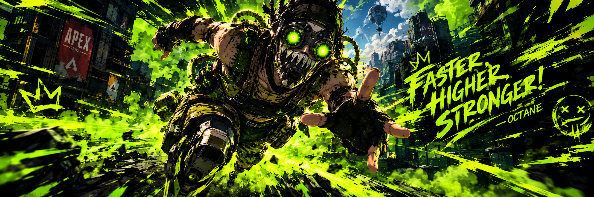

  

  🌐 <a href="https://fearlesswoofless-spec.github.io/Ulang-Portfolio/">Visit My Portfolio Website</a> |
  <a href="https://github.com/fearlesswoofless-spec">GitHub</a>

## About Me

Good morning, goodnight! I'm **Jan Kyle Ulang**, a fourth-year BS Computer Engineering student at **ICCT Cainta Colleges**.

I'm interested in databases, networking, and Artificial Intelligence. I have experience using Firebase and Supabase for database management, Java for application development, Python for simple coding projects, and AutoCAD for basic floor plans.

I'm continuously learning and improving my skills through school projects and hands-on practice.

## Skills

## Tools I Use

## Database Technologies

## Currently Learning

- Database design
- Computer networking
- Artificial Intelligence
- Java and Python application development

## Interests

Gaming, exploring technology, AI, and programming.

  

  <i>“Faster, higher, stronger!” — Octane</i>

  Thanks for visiting my profile! 💚

